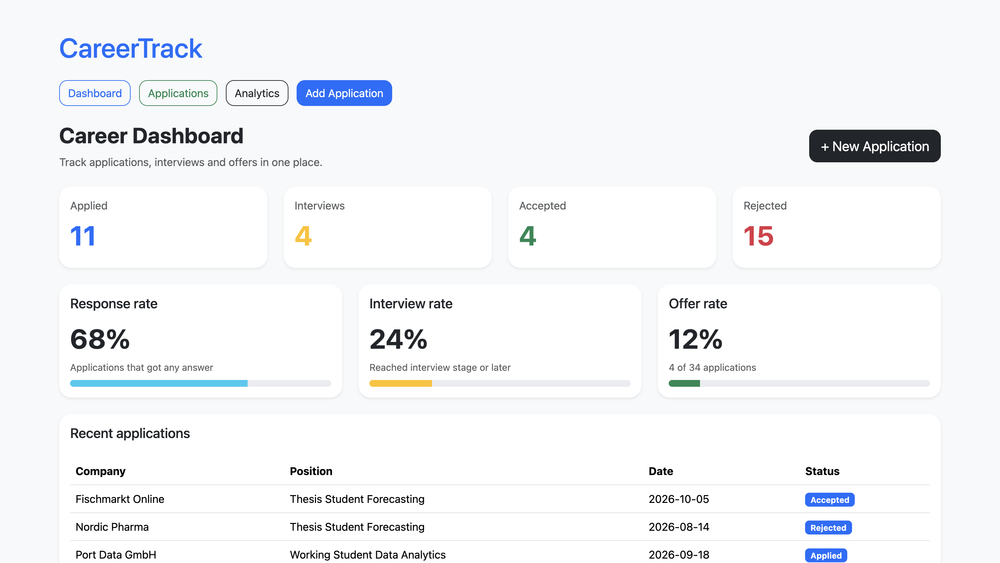
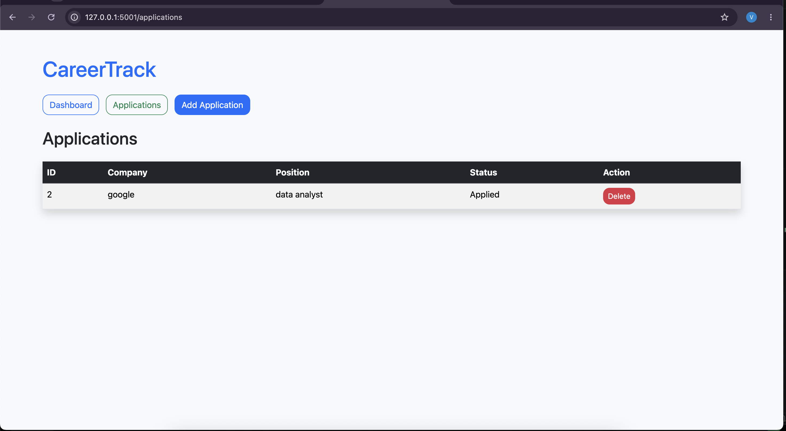
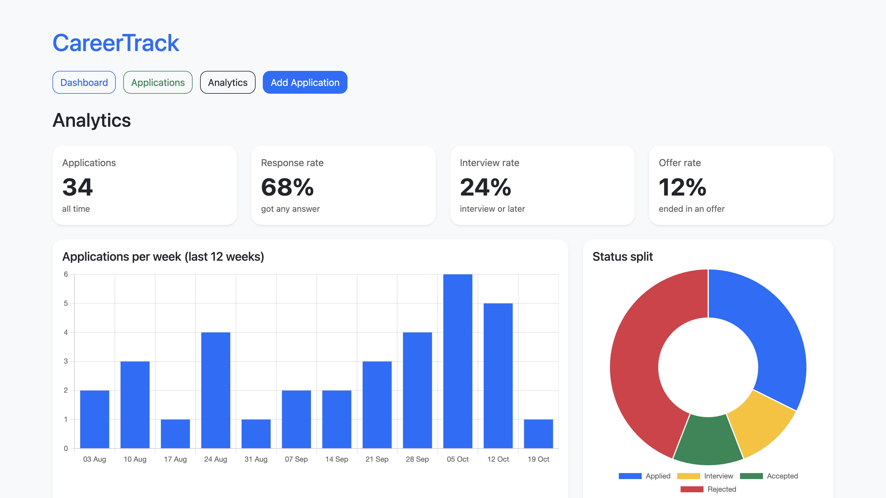

# CareerTrack – Job Application Tracker with Analytics

A small Flask web app to track job applications and see how a job search is going: response rate, interview rate, offers, weekly activity and which sources work best.

I built the first version as a Flask + SQLite + Docker project and later extended it with editing, search, CSV import/export, an analytics page, automated tests and CI.



## Features

- **Applications:** add, edit, delete, search by company or position, filter by status
- **Fields:** company, position, status (Applied / Interview / Accepted / Rejected), date applied, source, notes
- **Dashboard:** counts per status, response rate, interview rate, offer rate, recent applications
- **Analytics page:** applications per week (last 12 weeks), status split, funnel (applications → interview or later → offers), applications by source
- **CSV import / export:** back up your data or load an existing list; invalid rows are skipped and reported
- **JSON endpoint:** `GET /api/stats` returns the summary numbers
- **Tests and CI:** 22 pytest tests, run automatically by GitHub Actions on every push
- **Docker:** runs with gunicorn; the database lives in a volume




## How the metrics are defined

| Metric | Definition |
|---|---|
| Response rate | (Interview + Accepted + Rejected) ÷ all applications |
| Interview rate | (Interview + Accepted) ÷ all applications |
| Offer rate | Accepted ÷ all applications |

## Tech stack

Python 3.11, Flask, SQLite, Jinja2, Bootstrap 5, Chart.js, pytest, gunicorn, Docker, GitHub Actions

## Run locally

```bash
git clone https://github.com/somalavinay879-18/CareerTrack.git
cd CareerTrack
python -m venv venv
source venv/bin/activate          # Windows: venv\Scripts\activate
pip install -r requirements.txt
python app.py
```

Open http://localhost:5001. The database file `database.db` is created automatically. If you used an older version, your existing data is kept and the new columns are added automatically.

## Run with Docker

```bash
docker build -t careertrack .
docker run --rm -p 5001:5001 -v careertrack-data:/data careertrack
```

Open http://localhost:5001. The volume `careertrack-data` keeps your applications between runs.

## Run the tests

```bash
pip install -r requirements-dev.txt
pytest -q
```

The tests cover the pages, add / edit / delete, input validation, search and filters, CSV import and export (including spreadsheet formula protection), the analytics calculations, and migration of an old database.

## Try it with demo data

```bash
DATABASE=demo.db python seed_demo.py     # adds made-up demo rows
DATABASE=demo.db python app.py
```

## Project structure

```
CareerTrack/
├── app.py              # Flask app and routes
├── analytics.py        # metrics and chart data (pure functions, unit tested)
├── db.py               # SQLite connection and automatic migration
├── database.py         # creates / migrates the database from the command line
├── seed_demo.py        # demo data generator
├── templates/          # base, dashboard, applications, form, analytics
├── tests/test_app.py
├── .github/workflows/ci.yml
├── Dockerfile
├── requirements.txt
└── requirements-dev.txt
```

## Database

Table `applications`

| Field | Type | Description |
|---|---|---|
| id | INTEGER | Primary key |
| company | TEXT | Company name |
| position | TEXT | Job position |
| status | TEXT | Applied, Interview, Accepted or Rejected |
| date_applied | TEXT | ISO date (YYYY-MM-DD) |
| source | TEXT | e.g. LinkedIn, StepStone, referral |
| notes | TEXT | Free text, up to 1000 characters |

## Design notes

- All SQL uses parameters (no string-built queries). Jinja escapes all output.
- Deleting uses POST (not a link) so a crawler or a stray click cannot delete data.
- CSV export prefixes cells that start with `=`, `+`, `-` or `@` so Excel does not run them as formulas.
- Uploads are limited to 1 MB and 2,000 rows.
- Set `SECRET_KEY` as an environment variable if you deploy this publicly.

## Roadmap

- Time-to-response tracking (needs a response date per application)
- Email reminders for follow-ups
- User login for multi-user use
- Public demo deployment (Render)
